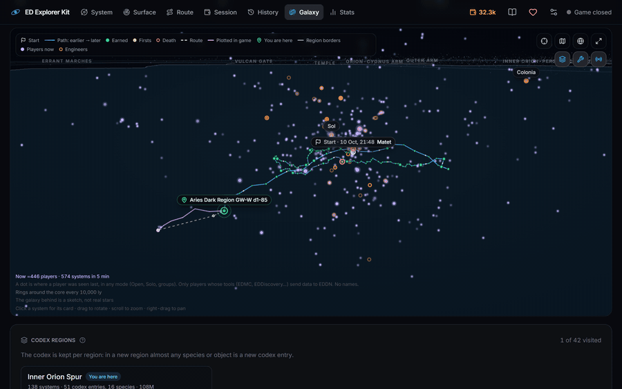
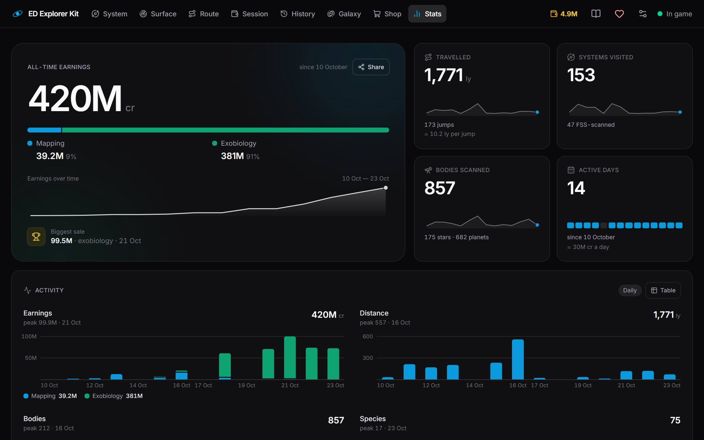

# ED Explorer Kit

**English** · [Русский](README.ru.md)

A companion app for Elite Dangerous explorers: exobiology and mapping with a clean,
glanceable interface for a second monitor. It reads the game journal on your PC and
shows everything in your browser.


- **System**: bodies ranked by value, bio signals, predicted species, whether a body is worth mapping.
- **Surface**: a sampling radar showing where to take the next sample and how far you still have to go.
- **Route**: systems worth visiting for high-value mapping (Road to Riches) and biology, around a point or along a line (Spansh data). Shown as a list or a 3D map, and stops tick off by themselves as you fly. Also covers the route you plotted in the galaxy map: fuel and where to scoop, neutron stars and white dwarfs ahead, and the chance a system is still undiscovered. Neutron routes come from Spansh.
- **Session**: how much unsold data you are carrying right now.
- **History**: every system you visited: what you scanned, found and sold.
- **Galaxy**: all your journeys on a 3D galaxy map: path, earnings, first discoveries, deaths, and the codex regions you have been to, the engineers with your progress. On request, other players right now (from EDDN, no names).
- **Stats**: all-time numbers and records.

<p>
  
  
</p>

The interface is in English, Ukrainian or Russian; switch it in Settings.

## Quick start (Windows)

1. Download **[EDExplorerKit.exe](../../releases/latest/download/EDExplorerKit.exe)** from the [latest release](../../releases/latest).
2. Run it. Your browser opens **http://127.0.0.1:8765** by itself.
3. Play. The page updates live while the game runs.

Close the black console window to stop the app. Running the exe again while it is already
running just opens the page.

**On your phone or tablet**: on the PC, open **Settings → On your phone** (or the button on the
welcome card) and scan the QR code with the phone, which has to be on the same Wi-Fi. On the first
start Windows asks about the firewall: allow private networks.

> Windows may show "Windows protected your PC" because the exe is not code-signed.
> Click **More info → Run anyway**. If you would rather not trust a downloaded exe, use
> Docker or run from source (below): both build from this repository's code.

If your journal is not in the standard place (`Saved Games\Frontier Developments\Elite Dangerous`),
the page says so: choose the folder in **Settings → Journal folder**.

On first start the app reads your whole journal history, which takes from a few seconds
to a minute.

## Run with Docker

Requires [Docker Desktop](https://www.docker.com/products/docker-desktop/). In the repository folder:

```powershell
docker compose up -d --build
```

Open **http://127.0.0.1:8765**. Stop it with `docker compose down`.

The journal folder `%USERPROFILE%\Saved Games\Frontier Developments\Elite Dangerous`
is mounted read-only. If yours is elsewhere (for example, Saved Games moved to OneDrive),
set `ED_JOURNAL_DIR` first:

```powershell
$env:ED_JOURNAL_DIR = "D:\OneDrive\Saved Games\Frontier Developments\Elite Dangerous"
docker compose up -d --build
```

The database is kept in the `data` Docker volume between restarts. To open the page from
other devices on your network, change the port line in `docker-compose.yml` to
`"8765:8765"`. In a container the app can't see the game process, so "game running"
in the header is judged from the journal.

## Run from source

Requires [uv](https://docs.astral.sh/uv/) and [Node.js](https://nodejs.org/) 22 or newer.
Clone or download this repository, then in its folder (PowerShell):

```powershell
.\start.ps1            # builds the UI, then serves http://127.0.0.1:8765, and to your phone on the same Wi-Fi
.\start.ps1 -Local     # this PC only
.\start.ps1 -SkipBuild # start without rebuilding the UI
```

If PowerShell says running scripts is disabled, start it as
`powershell -ExecutionPolicy Bypass -File .\start.ps1`.

Or step by step:

```powershell
cd frontend; npm install; npm run build; cd ..
cd backend;  uv run python -m app.main
```

## Options

Pass them to the exe (`EDExplorerKit.exe --offline`, or in a shortcut's target) or to
`uv run python -m app.main`.

| Option | What it does |
|---|---|
| `--local` | This PC only: no access from your phone or other devices on the network |
| `--offline` | No requests to Spansh/EDSM and no EDDN (route planning and live players are then off) |
| `--port 8765` | Use another port |
| `--journal-dir PATH` | Journal folder, if not in the standard place (or choose it in Settings; set here, Settings cannot change it) |
| `--data-dir PATH` | Where `data.db` is stored |
| `--rebuild` | Rebuild the database from the stored journal events |
| `--no-browser` | Don't open the browser on start (the exe opens it by default) |

## Your data

- The app reads the game journal (`Saved Games\Frontier Developments\Elite Dangerous`) and never writes to it.
- Devices on your network (your phone) can open the page; the journal folder can only be changed on the PC itself. `--local` keeps the page to this PC.
- The database lives in `%LOCALAPPDATA%\EDExplorerKit\data.db`. Deleting it is safe while the journals are there: it is rebuilt from them on the next start. It also stores the journal events themselves, so after losing the journals (reinstall, new PC) your history survives only in this file. Keep a copy.
- Only these requests go online: community data for the current system, route search, neutron routes and checks of the plotted route's systems (Spansh and EDSM). While the "players now" layer of the galaxy map is on, the app also listens to the [EDDN](https://github.com/EDCD/EDDN) relay: it only receives (about 20 KiB/s at busy times, the whole feed) and sends nothing; it hangs up a couple of minutes after the layer is closed. `--offline` turns them all off.

## Development

```powershell
cd backend;  uv run python -m app.main          # API on :8765
cd frontend; npm run dev                        # UI on :5173, proxies /api to the backend
cd frontend; npm run dev -- --open "/?mock=1"   # UI on mock data, no backend needed
cd backend;  uv run pytest -q
cd frontend; npm test
```

Architecture: [docs/ARCHITECTURE.md](docs/ARCHITECTURE.md). Roadmap: [docs/ROADMAP.md](docs/ROADMAP.md).

### Releasing

1. Bump the version in `backend/app/__init__.py` and `backend/pyproject.toml`.
2. Tag and push: `git tag v0.1.0; git push origin v0.1.0`.
3. The [Release workflow](.github/workflows/release.yml) tests the code, builds `EDExplorerKit.exe`
   and publishes it as a GitHub release.

To build the exe locally: `.\packaging\build-exe.ps1` produces `dist\EDExplorerKit.exe`.

## Credits

Community data: [Spansh](https://spansh.co.uk/) and [EDSM](https://www.edsm.net/).
Exobiology rules are derived from [Canonn](https://canonn.science/) research data
(details in [backend/app/exobio/SOURCES.md](backend/app/exobio/SOURCES.md)).
Other players: [EDDN](https://github.com/EDCD/EDDN), the Elite Dangerous Data Network.
Codex region map: [EliteDangerousRegionMap](https://github.com/klightspeed/EliteDangerousRegionMap)
by Ben Peddell (MIT, [backend/app/data/regionmap-LICENSE](backend/app/data/regionmap-LICENSE)).

ED Explorer Kit is a fan-made tool, not affiliated with or endorsed by Frontier Developments.
Elite Dangerous is a trademark of Frontier Developments plc.

## Support

ED Explorer Kit is free. If it helps you on your journeys, you can support its development on
[Patreon](https://www.patreon.com/mlinzo).

## Contact

Questions, ideas or bug reports: [mlinzo.dev@gmail.com](mailto:mlinzo.dev@gmail.com).

## License

[MIT](LICENSE)
