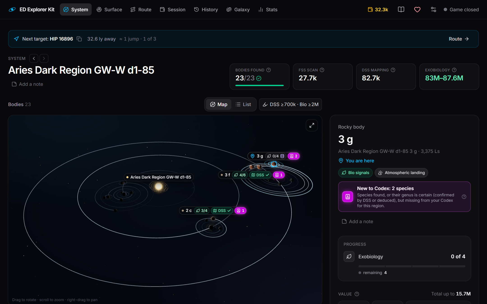

# ED Explorer Kit

[English](README.md) · **Русский**

Компаньон для исследователей Elite Dangerous: экзобиология и маппинг с простым
и понятным интерфейсом для второго монитора. Приложение читает журнал игры на вашем
компьютере и показывает всё в браузере.



- **Система** — тела по ценности, биосигналы, предсказанные виды, стоит ли маппить.
- **Поверхность** — радар сэмплов: где брать следующий образец и сколько ещё идти.
- **Маршрут** — системы, где можно заработать: картографирование дорогих планет (Road to Riches) и биология, вокруг точки или вдоль прямой (данные Spansh). Список или 3D-карта; прогресс отмечается сам по журналу. Здесь же маршрут, проложенный в галактической карте: хватит ли топлива и где заправиться, нейтронные звёзды и белые карлики впереди, шанс, что система ещё не открыта. Нейтронный маршрут — от Spansh.
- **Сессия** — сколько непроданных данных сейчас под риском.
- **История** — все посещённые системы: что отсканировано, найдено и продано.
- **Галактика** — все путешествия на 3D-карте галактики: путь, заработок, первооткрытия, гибели.
- **Статистика** — итоги и рекорды за всё время.

Интерфейс на английском, украинском или русском — переключается в настройках.

## Быстрый старт (Windows)

1. Скачайте **[EDExplorerKit.exe](../../releases/latest/download/EDExplorerKit.exe)** из [последнего релиза](../../releases/latest).
2. Запустите. Браузер сам откроет **http://127.0.0.1:8765**.
3. Играйте — страница обновляется на лету.

Чтобы остановить приложение, закройте чёрное окно консоли. Повторный запуск exe, когда
приложение уже работает, просто открывает страницу.

> Windows может показать «Система Windows защитила ваш компьютер»: exe не подписан.
> Нажмите **Подробнее → Выполнить в любом случае**. Если не хотите доверять скачанному exe —
> запустите через Docker или из исходников (ниже): оба способа собирают код из этого репозитория.

При первом запуске приложение читает всю историю журнала — от нескольких секунд до минуты.

## Запуск через Docker

Нужен [Docker Desktop](https://www.docker.com/products/docker-desktop/). В папке репозитория:

```powershell
docker compose up -d --build
```

Откройте **http://127.0.0.1:8765**. Остановить: `docker compose down`.

Папка журнала `%USERPROFILE%\Saved Games\Frontier Developments\Elite Dangerous`
подключается только для чтения. Если она в другом месте (например, Saved Games перенесены
в OneDrive), сначала задайте `ED_JOURNAL_DIR`:

```powershell
$env:ED_JOURNAL_DIR = "D:\OneDrive\Saved Games\Frontier Developments\Elite Dangerous"
docker compose up -d --build
```

База хранится в Docker-томе `data` и переживает перезапуски. Чтобы открыть страницу с других
устройств в сети, замените строку порта в `docker-compose.yml` на `"8765:8765"`. Из контейнера
процесс игры не виден, поэтому «игра запущена» в шапке определяется по журналу.

## Запуск вручную (из исходников)

Нужны [uv](https://docs.astral.sh/uv/) и [Node.js](https://nodejs.org/) 22+.
Склонируйте или скачайте репозиторий, затем в его папке (PowerShell):

```powershell
.\start.ps1            # собирает интерфейс и запускает http://127.0.0.1:8765
.\start.ps1 -Lan       # плюс доступ с других устройств в сети (Windows спросит про firewall)
.\start.ps1 -SkipBuild # запуск без пересборки интерфейса
```

Если PowerShell пишет, что выполнение сценариев отключено, запустите так:
`powershell -ExecutionPolicy Bypass -File .\start.ps1`.

Или по шагам:

```powershell
cd frontend; npm install; npm run build; cd ..
cd backend;  uv run python -m app.main
```

## Параметры

Передаются exe (`EDExplorerKit.exe --offline` или в свойствах ярлыка) либо
`uv run python -m app.main`.

| Параметр | Что делает |
|---|---|
| `--lan` | Доступ с других устройств в сети |
| `--offline` | Никаких запросов к Spansh/EDSM (планирование маршрута отключается) |
| `--port 8765` | Другой порт |
| `--journal-dir ПУТЬ` | Папка журнала, если она не на стандартном месте |
| `--data-dir ПУТЬ` | Где хранить `data.db` |
| `--rebuild` | Пересобрать базу из сохранённых событий журнала |
| `--no-browser` | Не открывать браузер при запуске (exe открывает по умолчанию) |

## Ваши данные

- Приложение читает журнал игры (`Saved Games\Frontier Developments\Elite Dangerous`) и ничего в него не пишет.
- База: `%LOCALAPPDATA%\EDExplorerKit\data.db`. Удалить её безопасно, пока на месте журналы: при следующем запуске всё пересоберётся из них. В базе лежат и сами события журнала, так что после потери журналов (переустановка, новый компьютер) история остаётся только в ней — этот файл лучше сохранить.
- В интернет уходят только запросы к Spansh и EDSM: данные о текущей системе, поиск для маршрута, нейтронный маршрут и проверка систем проложенного маршрута. `--offline` отключает их все.

## Разработка

```powershell
cd backend;  uv run python -m app.main          # API на :8765
cd frontend; npm run dev                        # UI на :5173 с прокси /api на бэкенд
cd frontend; npm run dev -- --open "/?mock=1"   # UI на тестовых данных без бэкенда
cd backend;  uv run pytest -q
cd frontend; npm test
```

Архитектура: [docs/ARCHITECTURE.md](docs/ARCHITECTURE.md). Планы: [docs/ROADMAP.md](docs/ROADMAP.md).

### Выпуск релиза

1. Поднимите версию в `backend/app/__init__.py` и `backend/pyproject.toml`.
2. Поставьте тег и запушьте его: `git tag v0.1.0; git push origin v0.1.0`.
3. [Workflow Release](.github/workflows/release.yml) прогонит тесты, соберёт `EDExplorerKit.exe`
   и опубликует его в GitHub Releases.

Собрать exe локально: `.\packaging\build-exe.ps1` → `dist\EDExplorerKit.exe`.

## Благодарности

Данные сообщества: [Spansh](https://spansh.co.uk/) и [EDSM](https://www.edsm.net/).
Правила экзобиологии выведены из исследовательских данных [Canonn](https://canonn.science/)
(подробности в [backend/app/exobio/SOURCES.md](backend/app/exobio/SOURCES.md)).

ED Explorer Kit — фанатский инструмент, не связан с Frontier Developments и не одобрен ею.
Elite Dangerous — торговая марка Frontier Developments plc.

## Поддержать

ED Explorer Kit бесплатный. Если он помогает вам в путешествиях, разработку можно поддержать на
[Patreon](https://www.patreon.com/mlinzo).

## Лицензия

[MIT](LICENSE)
